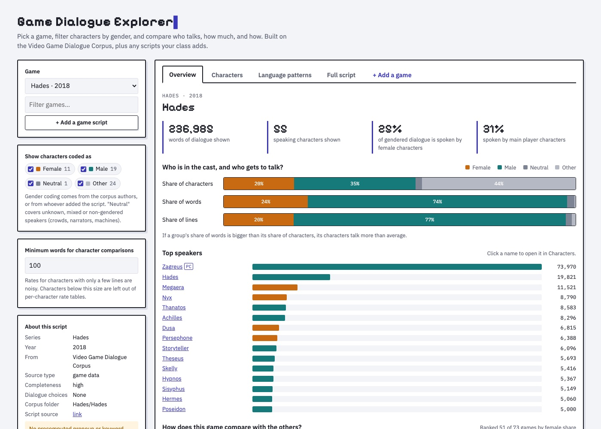
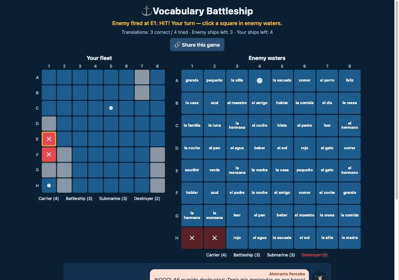

This page is a place for the apps and games I have been building. Some of them are tools for language teachers and others are games that try to make an argument. I will add more here as they are ready to share.

<hr>

# Game Dialogue Explorer

<div class="home-links" style="justify-content:flex-start">
<a href="https://fredpoole.github.io/game-dialogue-explorer/" target="_blank">Open the tool</a>
<a href="https://github.com/fredpoole/fredpoole.github.io/tree/master/game-dialogue-explorer" target="_blank">Source code</a>
</div>

```{r, fig.align='center', out.width = "700px", echo=FALSE}

```

A tool for studying how video games represent people through what their characters say. Students pick a game, filter the cast by gender, and compare who talks, how much, and how. The overview shows each gender's share of the cast next to its share of the dialogue, and how the game compares with every other game in the collection. The characters table and profiles show lines, words, and sentence length for each character, and the language patterns tab compares pronouns, question words, hedges, apologies, politeness, swearing, and the words that are most typical of one group or character compared with another.

It comes loaded with 73 game scripts from the <a href="https://github.com/seannyD/VideoGameDialogueCorpusPublic" target="_blank">Video Game Dialogue Corpus</a> by Seán G. Roberts, Stephanie Rennick, and colleagues, used under a CC BY 4.0 license. Disco Elysium, Genshin Impact, Grand Theft Auto V, Red Dead Redemption 2, Cyberpunk 2077, and Where Winds Meet (in Chinese, from the 燕云十六声 fan wiki) are built in too, from community transcripts and game data, with gender tags I added. Students can also add the games they are studying: paste or upload a transcript, tag each speaker's gender, and the game works in every tab. The bottom of the page links to places where students can find scripts for games like GTA V, Red Dead Redemption 2, Cyberpunk 2077, Baldur's Gate 3, Disco Elysium, and Genshin Impact. Added games keep only word counts, not the script text, and everything runs in the browser.

I made this for a representation case study assignment in my game studies course, where students analyze how a game portrays gender, race, culture, or class. The tool gives them evidence for one part of that argument: whose voices fill the game, and how those characters are written to speak.

<hr>

# Vocabulary Battleship

<div class="home-links" style="justify-content:flex-start">
<a href="https://fredpoole.github.io/battleship-vocabulary/" target="_blank">Play the game</a>
<a href="https://github.com/fredpoole/battleship-vocabulary" target="_blank">Source code</a>
</div>

```{r, fig.align='center', out.width = "700px", echo=FALSE}

```

A classic battleship game with a vocabulary twist. Students hide their fleet, and then every square in enemy waters shows a word in the language they are learning. To fire at a square they have to translate its word into English. Teachers pick the language from a dropdown: Spanish, French, German, Chinese, Japanese, Korean, or Arabic, the most commonly taught languages in U.S. schools. Chinese, Japanese, Korean, and Arabic words show their pronunciation too, and students can answer with either the characters or the pronunciation. A correct translation fires the cannon and shows a hit or a miss. A wrong one jams the cannon, shows the right answer, and gives the turn to the enemy. A pirate crew that speaks the target language reacts to every hit, miss, and sunk ship, so there is a little extra reading practice along the way, with an English button on each line for beginners. After every correct translation, students see two short example sentences (written at a novice-mid to novice-high level, with English translations) that show the word in use, and at the end of the game a translation report shows their accuracy, best streak, and a list of words to review.

Teachers can type in their own word list or upload one as a .txt or .csv file (one pair per line, either `word = translation` or two columns). The <b>Share this game</b> button copies a link that has the word list built in, so students open the game with your words already loaded. It runs in the browser on a computer, tablet, or phone.

I made this as one of a set of example apps for a vibe coding class I am teaching, where language teachers learn to build their own classroom tools by describing what they want to an AI coding assistant. A game like this one went from an idea to a working app in a single conversation, which is the point of the class: you do not need to be a programmer to make the tools you wish you had.

The game is also an example of building a minimum viable product (MVP). Instead of asking for everything at once, I started with the smallest version that worked: place your ships, translate a word, and fire. Once that was playing, I added one thing at a time and tested it before moving on. First the words appeared in the squares so students could see them before clicking, then uploading and sharing word lists, then the pirate dialogue in Spanish, then example sentences after each correct answer, then a stats report at the end of the game, and finally six more languages. Starting small keeps each step easy to check, and it means you always have a working app, even if you stop halfway.

<hr>

# Winning the Academic Game

<div class="home-links" style="justify-content:flex-start">
<a href="https://fredpoole.github.io/academic-game/" target="_blank">Play the game</a>
<a href="https://github.com/fredpoole/academic-game" target="_blank">Source code</a>
</div>

```{r, fig.align='center', out.width = "700px", echo=FALSE}
knitr::include_graphics("images/academicGameTitle.jpg")
```

## Why I made this game

In the past ten years anyone working at a university can tell you that general morale and belief in the academic institution is on the decline. The job market, publishing, peer review, public trust, and student literacy all seem to be failing at the same time. I have been arguing that these are not separate problems. They are the predictable outcome of one process, the gamification of the academy through what the philosopher C. Thi Nguyen calls value capture.

> "Value capture does not happen through coercion. It happens through seduction. A metric is offered as a convenient shorthand for something that matters and it is, initially, a reasonable shorthand."

A letter grade stands in for what a student learned. An impact factor or an h-index stands in for whether a scholar's work matters. Over time the proxy replaces the thing it was meant to represent. We stop asking whether we are doing good work and start asking whether our numbers are going up.

> "These metrics do not measure scholarly value. They measure scholarly legibility, the degree to which a scholar's output is visible within the citation economy. And once scholars understood that their careers depended on these numbers, they optimized for them."

I have written about this, but I am a games researcher, and it seemed fitting to make the argument as a game. Games are very good at teaching you to chase points. The idea was to build one where chasing the points works, and then show you at the end what it cost.

## How it plays

You play a newly hired Assistant Professor over a ten year career. Each year you split your work week across activities like deep research, salami-slicing papers, rigorous or crowd-pleasing teaching, mentoring, peer review, invisible service, and social media self-promotion. Events come up along the way (reviewer #2, an editorship offer, AI-drafted papers, donuts on evaluation day) and you only see the "game" effects of each choice. The university scores you on what it can count: publications, citations, grant dollars, teaching evaluations, and lines on your CV. You go up for reappointment in Year 3, tenure in Year 6, and Full Professor in Year 10.

```{r, fig.align='center', out.width = "700px", echo=FALSE}
knitr::include_graphics("images/academicGamePlan.jpg")
```

A hidden second scorecard tracks what the job is actually for: knowledge created, student learning, real service, and your own wellbeing. It is revealed at the end. In testing, players who purely game the metrics reach tenure almost every time while having very little real impact, and players who try to do the job well often do not make it.

At the start you also choose who your professor is. Identity does not change what you are able to do, but it does change how the system responds to what you do, following patterns documented in published research on teaching evaluations, citations, grant funding, and service loads. With identical choices, a balanced career reaches tenure about 23% of the time as a white man and about 14% as a Black woman. The effects and their sources are listed at the end of the game.

## What is to be done?

The game does not offer a fix, but the essay it came from ends with three: professionalizing peer review, unbundling the faculty role into research, teaching, and bridge tracks, and reclaiming evaluation from metrics.

> "The problems are the result of a system that has made it structurally difficult to do good work. Value capture does not require bad actors. It only requires metrics."

> "The game, as currently played, has no winner. Only an institution brave enough to stop playing it has any chance of remembering what it was supposed to be for."

The game takes about 20-30 minutes and runs in the browser on a computer or a phone (it takes about 15 seconds to load).

<b>References</b>

Hilpert, M. (2024). <a href="https://youtu.be/eKlEeKC8qLk" target="_blank">Academia is broken</a> [Video]. YouTube.

Nguyen, C. T. (2021). <i>Games: Agency as art.</i> Oxford University Press.
